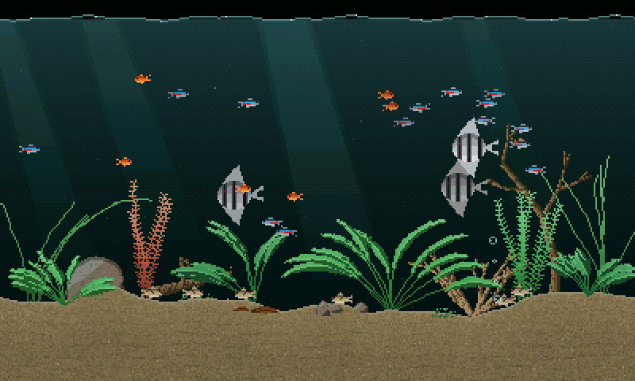
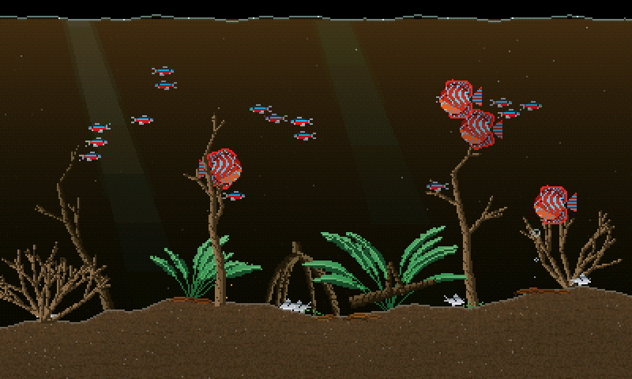
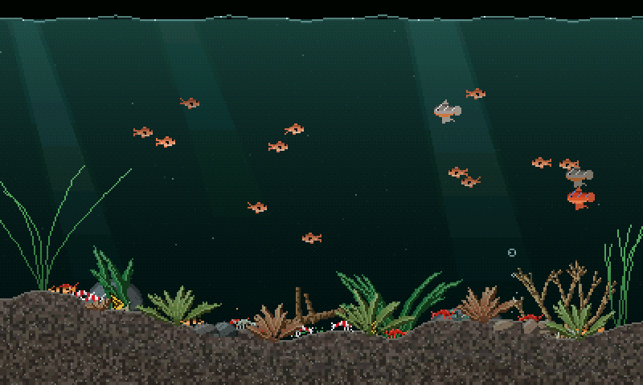
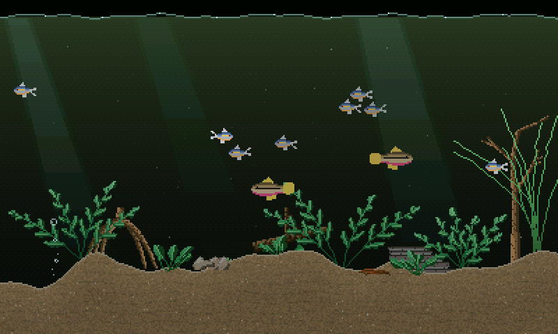
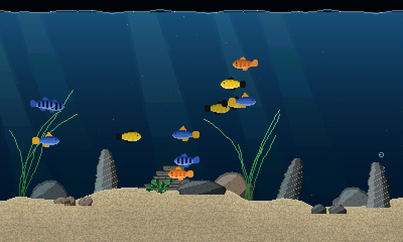
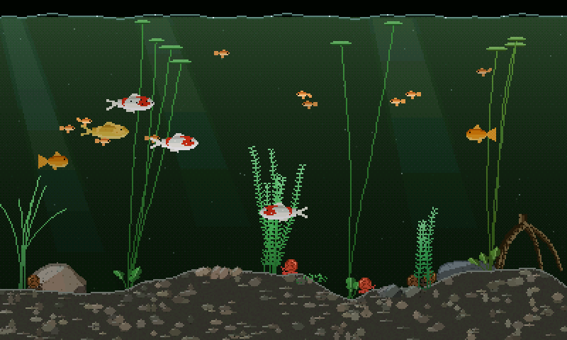

# Digital Aquarium

An animated **pixel-art freshwater aquarium** for the **Waveshare ESP32-S3-Touch-LCD-4.3**
(800×480 RGB panel, capacitive touch). Everything on screen (fish, shrimp, snails, plants, rocks,
wood, water and light) is generated procedurally in code, so all the art is original. The whole
tank can be customised from the touch screen. A desktop simulator (SDL2) runs the same code on
Linux.

| Amazzonico | Acque nere | Sud-Est Asia |
|---|---|---|
|  |  |  |
| **Africa Congo** | **Lago Malawi** | **Laghetto** |
|  |  |  |

*Screenshots from the simulator (`aquarium_headless`). The board renders the same frames.*

## Features

- **Pixel-art rendering**: a 400×240 RGB565 canvas, upscaled 2× in the LCD bounce-buffer
  interrupt. No 800×480 frame buffer is needed. The target is 30 FPS.
- **Living scene**: light rays, a wavy water surface, drifting particles, bubble columns,
  plants that sway, and an optional day/night cycle.
- **Behaviours**:
  - fish schools (boids on a spatial grid);
  - solitary fish that wander and pause;
  - bottom dwellers;
  - shrimp that walk, pick at the substrate and tail-flip away;
  - snails that crawl slowly and pull into their shell when touched.
- **Touch interaction**:
  - tap the water to drop food;
  - tap near a fish to scare it;
  - swipe with 2 fingers to change biome;
  - hold for 1 s to open the menu.
- **Full customisation from the screen**:
  - biome, water colours, light, substrate;
  - add, remove, move and recolour plants and decorations (edit mode with drag);
  - species, count and colour variants;
  - day/night, speed, brightness, FPS cap, screen-off timer;
  - 8 user presets.
- **Persistence**: the active tank is restored after a reboot. Presets are JSON files on
  LittleFS.

## Biomes (freshwater only)

| Biome | Environment | Plants & hardscape | Animals |
|---|---|---|---|
| **Amazzonico** (Amazon) | clear teal water, sand, strong light | Echinodorus, vallisneria, Rotala stems, Java moss; driftwood, spiderwood, tall branch, leaf litter | neon tetra, ember tetra, angelfish, corydoras |
| **Acque nere** (Blackwater) | tea-coloured tannin water, dim light, dark sand | tangle of tall branches, arching roots, spiderwood, catappa leaves; a few Echinodorus | cardinal tetra, discus, corydoras |
| **Sud-Est Asia** (South-East Asia) | Borneo stream, gravel | Cryptocoryne carpet, Microsorum, Bucephalandra, vallisneria; rocks, pebbles, wood | harlequin rasbora, gourami, kuhli loach, Caridina shrimp, assassin snail |
| **Africa Congo** | brownish-green water, sand | Bolbitis heudelotii, Anubias, vallisneria; roots, slate, driftwood | Congo tetra, kribensis |
| **Lago Malawi** (Lake Malawi) | clear blue water, pale sand, lots of light | piles of rock: boulders, tall Seiryu-style stones, stacked slate, pebbles; almost no plants | mbuna cichlids (3 colours), peacock cichlid |
| **Laghetto** (Pond) | green water, pebbles | water lilies with floating pads, Egeria, vallisneria; rocks and roots | koi (kohaku, sanke, ogon), goldfish, medaka, Planorbarius snails |

You can add any species, plant or decoration to any biome from the menu.

### Catalogue

- **Fish (16)**:
  - neon tetra, cardinal tetra, ember tetra, angelfish, discus, corydoras;
  - harlequin rasbora, gourami, kuhli loach;
  - Congo tetra, kribensis;
  - mbuna, peacock cichlid;
  - koi, goldfish, medaka.
- **Invertebrates (3)**:
  - Caridina shrimp (red cherry, crystal red, amano, blue dream);
  - Planorbarius ramshorn snail (brown, red, blue);
  - assassin snail (*Clea helena*).
- **Plants (10)**: stem plant (Rotala/Egeria), vallisneria, Cryptocoryne, Microsorum,
  Bolbitis heudelotii, Anubias, Bucephalandra, Echinodorus, Java moss, water lily.
- **Decorations (10)**: big rock, flat rock, tall stone, pebble cluster, stacked slate,
  driftwood log, spiderwood, tall branch, arching roots, catappa leaves.
- **Substrates**: sand, gravel, dark rock, pebbles, none.

## Hardware

- Waveshare **ESP32-S3-Touch-LCD-4.3**: ESP32-S3, 8 MB OPI PSRAM, 16 MB flash, 800×480 RGB
  panel, GT911 touch, CH422G IO expander.
- USB-C data cable.

## Quick start

**Simulator (Linux, SDL2):**

```bash
sudo dnf install SDL2-devel cmake ninja-build gcc
cmake -S sim -B build-sim -G Ninja && cmake --build build-sim
./build-sim/aquarium_sim                    # window
./build-sim/aquarium_headless /tmp/shots    # automatic test, must end with "ALL OK"
```

**Board (Arduino core `esp32` ≥ 3.1, tested with 3.3.12):** open `aquarium/aquarium.ino` and
select ESP32S3 Dev Module, **OPI PSRAM**, **16MB** flash and the **Custom** partition scheme. Or
use the command line:

```bash
FQBN="esp32:esp32:esp32s3:PSRAM=opi,FlashSize=16M,PartitionScheme=custom,CDCOnBoot=cdc"
arduino-cli compile --fqbn "$FQBN" aquarium
arduino-cli upload  --fqbn "$FQBN" -p /dev/ttyACM0 aquarium
```

On the first boot the LittleFS partition is formatted, so the screen can stay black for
10–30 s. All the details are in [BUILD.md](BUILD.md) and in the step-by-step guide.

## Controls

| Gesture (board) | Simulator | Action |
|---|---|---|
| Tap on the water | click | drop food |
| Tap near a fish | click | scare it (snails retract) |
| Hold 1 s | hold left button | open the settings menu |
| Double tap | double click | time / FPS overlay |
| 2-finger horizontal swipe | drag with right button | next / previous biome |
| — | `1`–`6`, `F`, `M`, `S`, `Esc` | biome, overlay, menu, PNG screenshot, quit |

## Project layout

```
aquarium/            Arduino sketch (aquarium.ino, partitions.csv)
└── src/
    ├── engine/      portable: canvas, 4 bpp sprites, font, PRNG/noise, math, gestures, hal.h
    ├── scene/       portable: water, substrate, plants, decor, bubbles, food, creatures, biomes
    ├── config/      portable: AquariumConfig, JSON, deferred storage
    ├── ui/          portable: pixel-art settings menu + edit mode
    ├── app/         portable: glue shared by board and simulator
    └── board/       ESP32 only: RGB panel, GT911, CH422G, HAL, FreeRTOS tasks, bring-up test
sim/                 SDL2 simulator + headless test
assets/tools/        png2c.py (indexed PNG -> C sprite sheet)
docs/                guides, benchmark sheet, original spec, screenshots, reference image
```

Only `src/board/` touches ESP-IDF/Arduino. Everything else talks to the hardware through
`src/engine/hal.h`, so the simulator runs the exact same scene, UI and storage code.

## Documentation

| File | Content |
|---|---|
| [BUILD.md](BUILD.md) | build options, simulator, architecture notes, differences from the spec |
| [docs/GUIDE_EN.md](docs/GUIDE_EN.md) | step-by-step flashing and test guide (English) |
| [docs/GUIDA_IT.md](docs/GUIDA_IT.md) | the same guide in Italian |
| [docs/benchmark.md](docs/benchmark.md) | rendering benchmark method and results sheet |
| [docs/SPEC_IT.md](docs/SPEC_IT.md) | original project specification (Italian) |

## Known limitations

- **Short glitch when settings are saved.** The precompiled Arduino core does not set
  `CONFIG_LCD_RGB_ISR_IRAM_SAFE`, so during a flash write the LCD interrupt stops and the
  picture shows stretched or shifted lines until the next refresh. To keep this rare, nothing
  is written while the menu or edit mode is open. Unchanged settings are never written. The
  active tank is saved as a single NVS record about 2 s after the menu closes.
- Changes made while the menu is open are lost if power is cut before the menu is closed.
- Not implemented yet: Wi-Fi/NTP clock, web page, assets from microSD, OTA updates.
- Saved settings from firmware before the freshwater-biomes update are not migrated. The tank
  starts again from the Amazzonico biome.
